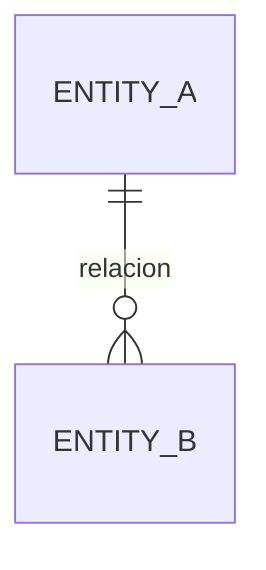

# Diseño de base de datos

Pendiente de seleccionar el negocio y validar sus reglas.

Entregables: diagrama ER, diccionario de datos, claves y cardinalidades, restricciones, índices justificados y migraciones.

Criterios: normalización razonable, nulabilidad explícita, integridad referencial y restricciones `UNIQUE`, `NOT NULL` y `CHECK` cuando proceda.

Sustituir el ejemplo al definir las entidades reales.
